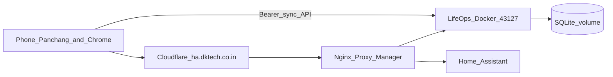

# Home Assistant–first Life Ops + Daily Panchang

## Rethink (what changed)

| Old idea | New idea |
|----------|----------|
| Temporary Cloudflare tunnel from Cursor cloud | **Permanent on your HA host** |
| Life Ops as a floating demo | **Household backend next to HA** |
| Panchang talks to a random tunnel URL | Panchang talks to **your domain** |
| SSH from the cloud agent | **You deploy on LAN** (Portainer preferred) |



**Source of truth**

- Festivals / tithi / Hindu calendar UI → **Daily Panchang**
- Tasks, shopping, payments, care, trackers, AI → **Life Ops on HA**
- Home automation / devices → **Home Assistant**

---

## Recommended public URL

Use a **subdomain** (simplest for Next.js / PWA):

```text
https://lifeops.dktech.co.in  →  http://192.168.1.8:43127
```

Avoid serving under `https://ha.dktech.co.in/life-ops` unless you rebuild with `LIFEOPS_BASE_PATH=/life-ops`.

---

## Deploy with Portainer (preferred)

Do this on a PC that can open Portainer on your LAN (`http://192.168.1.8:9000` or whatever you use).

### 1. Put the code on the HA host

From a home-WiFi PC:

```bash
ssh deepak01@192.168.1.8
mkdir -p ~/lifeops && cd ~/lifeops
# copy files however you like: git clone, scp, or USB
```

Or from your laptop (with the repo checked out):

```bash
rsync -av --exclude node_modules --exclude .next --exclude data \
  ./ deepak01@192.168.1.8:~/lifeops/
```

### 2. Portainer → Stacks → Add stack

- Name: `lifeops`
- Build method: **Upload** / **Repository** / or use **Compose path** `~/lifeops` if Portainer can see the host filesystem
- Compose file: use [`deploy/portainer-stack.yml`](../deploy/portainer-stack.yml) (same as root `docker-compose.yml`)

Environment variables in Portainer:

| Name | Example |
|------|---------|
| `LIFEOPS_MEMBER1_PIN` | strong PIN (not 1234 in production) |
| `LIFEOPS_MEMBER2_PIN` | partner PIN |
| `LIFEOPS_API_KEY` | Gemini / OpenAI key (optional) |
| `LIFEOPS_LLM_BASE_URL` | `https://generativelanguage.googleapis.com/v1beta/openai/` |
| `LIFEOPS_LLM_MODEL` | `gemini-2.0-flash` |

Deploy the stack. Confirm:

```bash
docker ps | grep lifeops
curl -s http://127.0.0.1:43127/api/auth
```

### 3. Nginx Proxy Manager

Add Proxy Host:

| Field | Value |
|--------|--------|
| Domain | `lifeops.dktech.co.in` |
| Scheme | `http` |
| Forward hostname | `192.168.1.8` (or `lifeops` if same Docker network) |
| Forward port | `43127` |
| SSL | Let’s Encrypt / Cloudflare |

Cloudflare DNS: `lifeops` CNAME/A to same target as `ha`, proxy on.

### 4. Optional HA sidebar

HA → Settings → Dashboards → add a **Webpage** card / panel iframe:

`https://lifeops.dktech.co.in`

---

## Integrate Daily Panchang

In Panchang app Settings:

| Field | Value |
|--------|--------|
| **Base URL** | `https://lifeops.dktech.co.in` |
| **PIN** | your Life Ops PIN |

Sync uses:

- `POST /api/auth` → token  
- `GET /api/sync` → pull tasks/dates onto calendar + widget  
- `POST /api/sync` → add/complete/toggle shopping from Panchang  

Contract: [PANCHANG_SYNC_API.md](./PANCHANG_SYNC_API.md)

---

## One-shot from home PC (SSH instead of Portainer UI)

```bash
export HA_HOST=192.168.1.8
export HA_USER=deepak01
export HA_PASS='…'   # do not commit
export LIFEOPS_API_KEY='…'
bash scripts/deploy-ha-ssh.sh
```

Then create the NPM host `lifeops.dktech.co.in` as above.

---

## Why the cloud agent cannot finish deploy for you

- `192.168.1.8` is LAN-only  
- `ha.dktech.co.in` is Cloudflare HTTP — SSH is not exposed  

You (or Portainer on the LAN) must run the container once. After that, phones use the public HTTPS URL forever.
